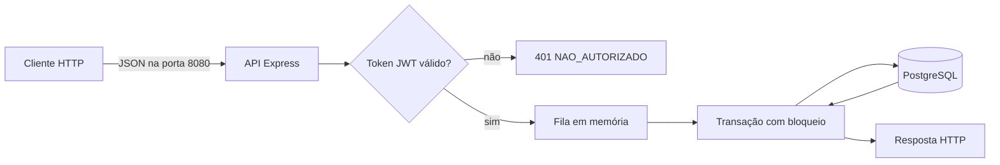
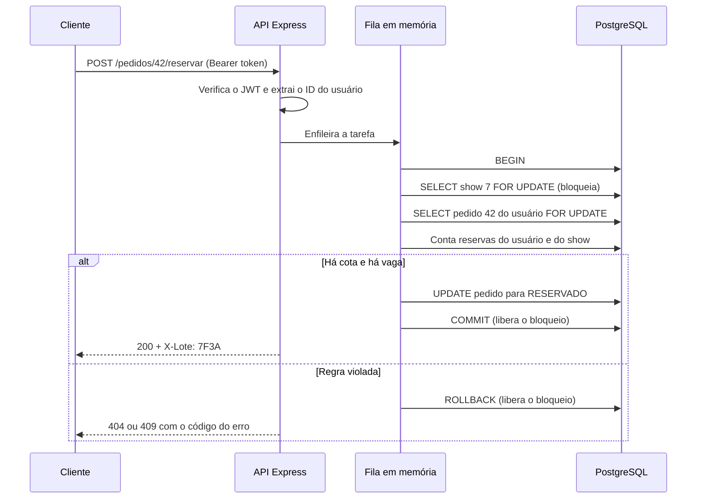
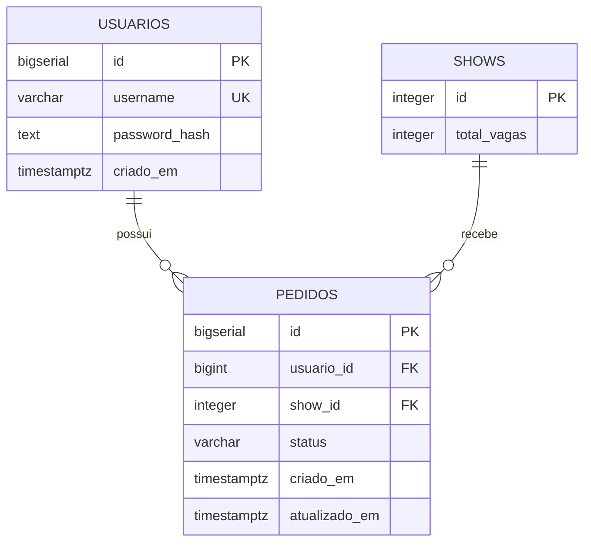
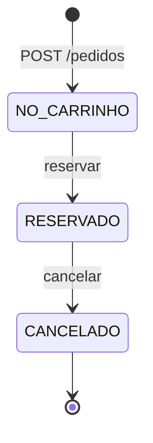

# API sob Alta Demanda — Documento do Projeto

Este documento explica o projeto do início ao fim: o problema, as tecnologias, o funcionamento, a estratégia de concorrência, os testes realizados e as limitações conhecidas. Ele complementa o [README.md](README.md), que traz as instruções rápidas de execução.

## Sumário

1. [Apresentação do projeto](#1-apresentação-do-projeto)
2. [Tecnologias utilizadas](#2-tecnologias-utilizadas)
3. [Estrutura de pastas](#3-estrutura-de-pastas)
4. [Arquitetura e funcionamento](#4-arquitetura-e-funcionamento)
5. [Banco de dados](#5-banco-de-dados)
6. [Endpoints](#6-endpoints)
7. [Concorrência](#7-concorrência)
8. [Testes executados](#8-testes-executados)
9. [Como executar](#9-como-executar)
10. [Limitações conhecidas](#10-limitações-conhecidas)
11. [Perguntas prováveis do professor](#11-perguntas-prováveis-do-professor)
12. [Roteiro de apresentação de 5 minutos](#12-roteiro-de-apresentação-de-5-minutos)
13. [Glossário](#13-glossário)

---

## 1. Apresentação do projeto

### Objetivo

A API permite reservar ingressos para um show. O usuário se cadastra, faz login, cria um pedido, reserva esse pedido e, se quiser, cancela a reserva. Também é possível consultar quantas vagas estão ocupadas e quantas estão livres.

### O problema

Vender ingressos parece simples: basta contar quantos já foram reservados e, se ainda houver vaga, confirmar mais um. O problema aparece quando **muitas pessoas tentam ao mesmo tempo**.

Imagine que resta um único ingresso e duas pessoas clicam em "reservar" no mesmo instante. Se o sistema apenas contar e depois gravar, as duas requisições podem ler "99 ocupadas", as duas concluem que há vaga e as duas gravam. O resultado seria 101 ingressos vendidos para um show de 100 lugares. Esse erro é chamado de *overselling* e nasce de uma **condição de corrida**.

O objetivo central do projeto é impedir que isso aconteça, mesmo com centenas de requisições simultâneas.

### Regras de negócio

| Regra | Valor |
|---|---|
| Limite global de ingressos reservados | 100 |
| Limite de reservas ativas por usuário | 2 |
| Show disponível | apenas o de ID 7 |
| Quem pode reservar ou cancelar um pedido | somente o dono do pedido |

Uma reserva "ativa" é um pedido no estado `RESERVADO`. Pedidos apenas criados (`NO_CARRINHO`) ou cancelados (`CANCELADO`) não ocupam vaga nem contam na cota pessoal.

---

## 2. Tecnologias utilizadas

| Tecnologia | O que é | Função neste projeto |
|---|---|---|
| **Node.js 22** | Ambiente que executa JavaScript fora do navegador. | Executa a API. Processa as requisições em uma única thread principal, o que torna a fila em memória simples e segura. |
| **Express 5** | Biblioteca para criar servidores HTTP em Node.js. | Define as rotas (`/auth/login`, `/pedidos` etc.), interpreta o JSON recebido e centraliza o tratamento de erros. |
| **PostgreSQL 17** | Banco de dados relacional. | Guarda usuários, o show e os pedidos. Fornece as transações e os bloqueios de linha que garantem a consistência das reservas. |
| **pg** | Biblioteca que conecta Node.js ao PostgreSQL. | Mantém um conjunto (pool) de até 15 conexões reutilizáveis com o banco e envia os comandos SQL. |
| **JWT (jsonwebtoken)** | Padrão de token assinado digitalmente. | Depois do login, a API entrega um token. Nas rotas protegidas, o token prova quem é o usuário sem consultar a senha novamente. Usa o algoritmo HS256 e vale 24 horas. |
| **bcryptjs** | Biblioteca de hash de senhas. | Transforma a senha em um hash antes de salvar. A senha original nunca é gravada no banco. |
| **Docker** | Ferramenta que empacota um programa com tudo de que ele precisa. | Empacota a API em uma imagem baseada em `node:22-alpine`. Quem avalia não precisa instalar Node.js nem PostgreSQL. |
| **Docker Compose** | Ferramenta que sobe vários contêineres juntos. | Sobe o banco e a API com um único comando, cria as tabelas automaticamente e só inicia a API depois que o banco está pronto. |

O arquivo `package-lock.json` fixa a versão exata de todas as dependências, inclusive as indiretas. O `Dockerfile` usa `npm ci`, que instala exatamente o que está nesse arquivo, tornando o build reproduzível.

---

## 3. Estrutura de pastas

```text
.
├── src/
│   ├── app.js          # Servidor Express: rotas, validações e respostas HTTP
│   ├── auth.js         # Geração e verificação do token JWT
│   ├── db.js           # Pool de conexões com o PostgreSQL
│   ├── erros.js        # Classe de erro HTTP padronizado
│   └── reservas.js     # Fila em memória + transação de reserva e cancelamento
├── database/
│   └── init.sql        # Criação das tabelas e do show de ID 7
├── scripts/
│   ├── test-api.mjs           # Teste funcional sequencial
│   ├── test-regras.mjs        # Regras de negócio sob concorrência
│   ├── test-concorrencia.mjs  # 130 reservas simultâneas
│   └── test-carga.mjs         # Medição de desempenho progressiva
├── Dockerfile          # Como construir a imagem da API
├── docker-compose.yml  # Como subir banco + API
├── package.json        # Dependências e scripts
├── package-lock.json   # Versões exatas das dependências
├── README.md           # Instruções rápidas
└── DOCUMENTO.md        # Este documento
```

| Arquivo | Responsabilidade |
|---|---|
| `src/app.js` | Recebe as requisições, valida os dados de entrada, chama as regras e devolve o código HTTP e o JSON. Também define o header `X-Lote` e o tratamento central de erros. |
| `src/auth.js` | `gerarToken` cria o JWT no login. `autenticar` é o middleware que exige `Authorization: Bearer <token>` e responde 401 quando o token falta ou é inválido. |
| `src/db.js` | Cria o pool de conexões. Os dados de acesso vêm de variáveis de ambiente definidas no Compose. |
| `src/erros.js` | Define `ErroHttp`, que carrega o status HTTP e o código de erro (por exemplo, 409 e `POOL_CHEIO`). |
| `src/reservas.js` | **Coração do projeto.** Contém a fila em memória e a função `alterarReserva`, que executa reserva e cancelamento dentro de uma transação com bloqueio. |
| `database/init.sql` | Executado automaticamente pelo PostgreSQL na primeira inicialização do volume. |

---

## 4. Arquitetura e funcionamento

### Visão geral



Somente as rotas de **reservar** e **cancelar** passam pela fila. Registro, login, criação de pedido e consulta do pool falam com o banco diretamente, porque não alteram a quantidade de vagas ocupadas.

### Passo a passo de uma reserva



### Ordem das verificações na reserva

Dentro da transação, as verificações acontecem sempre nesta ordem:

1. O pedido existe **e** pertence ao usuário do token? Se não, `404 PEDIDO_NAO_ENCONTRADO`.
2. O pedido está em `NO_CARRINHO`? Se não, `409 ESTADO_INVALIDO`.
3. O usuário tem menos de 2 reservas ativas? Se não, `409 COTA_PESSOAL`.
4. O show tem menos de 100 reservas ativas? Se não, `409 POOL_CHEIO`.

A cota pessoal é verificada antes do pool. Assim, um usuário que já tem duas reservas recebe `COTA_PESSOAL` mesmo quando o show está lotado.

### Tratamento de erros

Todos os erros de regra são lançados como `ErroHttp` e convertidos em um JSON no formato `{"error": "CODIGO"}`. Erros não previstos são registrados no log e respondidos com `500 ERRO_INTERNO`.

---

## 5. Banco de dados

### Modelo



### Tabelas

- **`usuarios`**: um registro por pessoa cadastrada. O `username` é único (`UNIQUE`); é essa restrição que gera o erro de usuário duplicado. A senha é guardada apenas como hash.
- **`shows`**: contém uma única linha, o show de ID 7, com `total_vagas = 100`. Um `CHECK (total_vagas = 100)` impede alterar esse total. Essa linha também serve como **ponto de bloqueio** das reservas (ver seção 7).
- **`pedidos`**: cada pedido pertence a um usuário e a um show (chaves estrangeiras). O `status` só aceita três valores, garantidos por um `CHECK`.

### Como as vagas são contadas

Não existe uma coluna "vagas ocupadas". A ocupação é sempre calculada contando os pedidos com `status = 'RESERVADO'`. Isso evita que um contador separado fique diferente da realidade.

### Índices

Dois índices parciais aceleram as contagens, pois incluem apenas os pedidos `RESERVADO`:

- `idx_pedidos_ativos_show`: reservas ativas por show.
- `idx_pedidos_ativos_usuario`: reservas ativas por usuário.

### Estados do pedido



| Estado | Ocupa vaga? | Conta na cota pessoal? |
|---|---|---|
| `NO_CARRINHO` | Não | Não |
| `RESERVADO` | Sim | Sim |
| `CANCELADO` | Não | Não |

Qualquer outra transição (reservar um pedido já reservado ou cancelado, cancelar um pedido que não está reservado) responde `409 ESTADO_INVALIDO`.

---

## 6. Endpoints

Todas as respostas de erro têm o formato `{"error": "CODIGO"}`. As rotas marcadas com 🔒 exigem o header `Authorization: Bearer <token>`; sem ele ou com token inválido, a resposta é `401 {"error":"NAO_AUTORIZADO"}`.

### 6.1 `POST /auth/registrar`

Cadastra um usuário. Não exige autenticação.

Body:

```json
{ "username": "joao", "password": "senha123" }
```

| Situação | Resposta |
|---|---|
| Sucesso | `201 Created`, sem corpo |
| Dados ausentes ou inválidos | `400 {"error":"DADOS_INVALIDOS"}` |
| JSON malformado | `400 {"error":"JSON_INVALIDO"}` |
| Usuário já cadastrado | `409 {"error":"USUARIO_JA_EXISTE"}` |

Regras de validação: `username` é texto não vazio de até 50 caracteres; `password` é texto não vazio de até 72 bytes (limite do bcrypt).

### 6.2 `POST /auth/login`

Autentica e devolve o token. Não exige autenticação.

Body:

```json
{ "username": "joao", "password": "senha123" }
```

Sucesso, `200 OK`:

```json
{ "token": "eyJhbGciOiJIUzI1NiIs..." }
```

| Situação | Resposta |
|---|---|
| Dados ausentes ou inválidos | `400 {"error":"DADOS_INVALIDOS"}` |
| Usuário inexistente ou senha errada | `401 {"error":"CREDENCIAIS_INVALIDAS"}` |

### 6.3 `POST /pedidos` 🔒

Cria um pedido no estado `NO_CARRINHO`. Criar um pedido **não** ocupa vaga.

Body:

```json
{ "showId": 7 }
```

Sucesso, `201 Created`:

```json
{ "id": 42, "status": "NO_CARRINHO" }
```

| Situação | Resposta |
|---|---|
| `showId` diferente de 7 (ou ausente) | `404 {"error":"SHOW_NAO_ENCONTRADO"}` |

### 6.4 `POST /pedidos/{id}/reservar` 🔒

Reserva um ingresso para o pedido. Não tem body.

Sucesso, `200 OK`, **com o header `X-Lote: 7F3A`**:

```json
{ "id": 42, "status": "RESERVADO" }
```

| Situação | Resposta |
|---|---|
| Pedido inexistente ou de outro usuário | `404 {"error":"PEDIDO_NAO_ENCONTRADO"}` |
| Pedido já reservado ou cancelado | `409 {"error":"ESTADO_INVALIDO"}` |
| Usuário já tem 2 reservas ativas | `409 {"error":"COTA_PESSOAL"}` |
| As 100 vagas estão ocupadas | `409 {"error":"POOL_CHEIO"}` |

O header `X-Lote` aparece **somente** nas reservas bem-sucedidas. Respostas de erro não o contêm.

### 6.5 `POST /pedidos/{id}/cancelar` 🔒

Cancela uma reserva e devolve a vaga ao pool. Não tem body.

Sucesso, `200 OK` (sem `X-Lote`):

```json
{ "id": 42, "status": "CANCELADO" }
```

| Situação | Resposta |
|---|---|
| Pedido inexistente ou de outro usuário | `404 {"error":"PEDIDO_NAO_ENCONTRADO"}` |
| Pedido que não está `RESERVADO` | `409 {"error":"ESTADO_INVALIDO"}` |

### 6.6 `GET /pool` 🔒

Mostra a ocupação do show.

Sucesso, `200 OK`:

```json
{ "total": 100, "ocupadas": 37, "livres": 63 }
```

`ocupadas` é contado em uma única consulta e `livres` é calculado como `total - ocupadas`. Por isso `ocupadas + livres` é sempre 100.

### Observações

- Pedidos de outro usuário respondem 404, igual a um pedido inexistente. Assim, ninguém descobre quais IDs existem.
- Existe uma rota extra, `GET /health`, sem autenticação, usada pelo Docker para saber se a API está no ar. Ela não faz parte do enunciado.
- Qualquer rota não definida responde `404 {"error":"ROTA_NAO_ENCONTRADA"}`.

---

## 7. Concorrência

Esta é a parte mais importante do projeto.

### 7.1 O que é uma condição de corrida

Uma condição de corrida acontece quando o resultado de um programa depende da **ordem em que operações simultâneas se intercalam**. O erro clássico é o padrão "verificar e depois agir": entre a verificação e a ação, outra requisição pode mudar a situação.

### 7.2 A disputa pela última vaga (versão ingênua)

Suponha 99 vagas ocupadas e duas pessoas, Ana e Bruno, reservando ao mesmo tempo em um sistema **sem proteção**:

| Momento | Requisição da Ana | Requisição do Bruno |
|---|---|---|
| 1 | Conta as reservas: 99 | |
| 2 | | Conta as reservas: 99 |
| 3 | 99 < 100, há vaga | |
| 4 | | 99 < 100, há vaga |
| 5 | Grava RESERVADO (100) | |
| 6 | | Grava RESERVADO (**101**) |

As duas decisões foram tomadas com a mesma informação, que já estava desatualizada quando Bruno gravou.

### 7.3 A solução deste projeto: duas camadas

O projeto usa duas proteções que trabalham juntas, ambas em `src/reservas.js`.

**Camada 1 — Fila em memória (dentro da API).** Toda reserva e todo cancelamento entram em uma fila. A API executa uma tarefa de cada vez, na ordem em que as tarefas foram enfileiradas pelo processo Node. A próxima só começa quando a anterior termina, com sucesso ou com erro. Um erro em uma tarefa não trava as seguintes.

**Camada 2 — Transação com bloqueio (dentro do PostgreSQL).** Cada tarefa abre uma transação e bloqueia a linha do show antes de contar qualquer coisa. Essa camada protege os dados mesmo que exista mais de um processo acessando o banco.

### 7.4 BEGIN, SELECT FOR UPDATE, COMMIT e ROLLBACK

- **`BEGIN`** abre uma transação: um conjunto de comandos tratado como uma unidade.
- **`SELECT ... FOR UPDATE`** lê uma linha e a **bloqueia**. Qualquer outra transação que tente bloquear a mesma linha fica esperando.
- **`COMMIT`** confirma tudo o que a transação fez e libera os bloqueios.
- **`ROLLBACK`** desfaz tudo o que a transação fez e também libera os bloqueios.

No projeto, a primeira ação de toda reserva ou cancelamento é:

```sql
SELECT total_vagas FROM shows WHERE id = 7 FOR UPDATE;
```

Como só existe uma linha de show, ela funciona como uma **catraca**: só passa uma transação por vez. Quem chega enquanto a catraca está ocupada espera o `COMMIT` ou o `ROLLBACK` de quem está dentro.

### 7.5 Por que duas transações não reservam a mesma vaga

A contagem de reservas é feita **depois** de obter o bloqueio, e o bloqueio só é liberado **depois** de gravar. Portanto, quando uma transação conta, nenhuma outra pode estar no meio de uma reserva. A contagem está sempre atualizada.

A mesma disputa entre Ana e Bruno, agora com o bloqueio:

| Momento | Transação da Ana | Transação do Bruno |
|---|---|---|
| 1 | `BEGIN` | `BEGIN` |
| 2 | Bloqueia o show ✅ | Tenta bloquear o show ⏳ espera |
| 3 | Conta: 99 ocupadas | ⏳ |
| 4 | 99 < 100: grava RESERVADO | ⏳ |
| 5 | `COMMIT` (libera o bloqueio) | Obtém o bloqueio ✅ |
| 6 | Resposta 200 + `X-Lote: 7F3A` | Conta: **100** ocupadas |
| 7 | | 100 não é menor que 100: `ROLLBACK` |
| 8 | | Resposta 409 `POOL_CHEIO` |

Com uma única instância da API, a fila em memória já impede que as duas transações rodem ao mesmo tempo; o bloqueio do banco é a segunda barreira.

### 7.6 Como a cota de duas reservas é protegida

A contagem das reservas do usuário é feita **dentro da mesma transação**, depois do bloqueio do show. Como todas as reservas passam por esse bloqueio, duas reservas do mesmo usuário nunca são avaliadas ao mesmo tempo. Se um usuário disparar cinco reservas simultâneas, elas são processadas uma por uma: as duas primeiras encontram 0 e 1 reservas ativas e são aprovadas; as três seguintes encontram 2 e recebem `COTA_PESSOAL`.

O mesmo vale para várias tentativas sobre o **mesmo pedido**: a primeira muda o estado para `RESERVADO`; as demais encontram o pedido já reservado e recebem `ESTADO_INVALIDO`.

### 7.7 Por que cancelar libera uma vaga

A ocupação é a contagem de pedidos `RESERVADO`. Ao cancelar, o pedido passa a `CANCELADO` e simplesmente deixa de ser contado. Não há contador para decrementar, então não há risco de o contador ficar errado.

O cancelamento usa a mesma fila e o mesmo bloqueio da reserva. Assim, um cancelamento e uma reserva simultâneos também são processados um de cada vez.

### 7.8 Como o banco preserva a consistência

- Se qualquer passo falhar, o `ROLLBACK` desfaz a transação inteira. Não existe "meia reserva".
- A conexão é sempre devolvida ao pool, com sucesso ou com erro.
- O `CHECK` do status impede valores fora dos três estados.
- As chaves estrangeiras impedem pedidos de usuários ou shows inexistentes.
- A consulta do pool lê apenas dados já confirmados (`COMMIT`), em uma única consulta.

### 7.9 Atomicidade, serialização e justiça FIFO

São três ideias diferentes, e é importante não confundi-las:

| Conceito | Pergunta que responde | Quem garante no projeto |
|---|---|---|
| **Atomicidade** | A operação acontece por inteiro ou não acontece? | A transação (`BEGIN` ... `COMMIT`/`ROLLBACK`). |
| **Serialização** | As operações concorrentes se comportam como se fossem executadas uma de cada vez? | O bloqueio da linha do show (e, em uma instância, também a fila). |
| **Justiça FIFO** | Quem pediu primeiro é atendido primeiro? | A fila em memória, **dentro de uma instância**. |

Atomicidade e serialização garantem a **integridade**: nunca mais de 100 reservas, nunca mais de 2 por usuário. Elas não dizem nada sobre **quem** fica com a última vaga. Isso é assunto da justiça FIFO.

### 7.10 O que a fila garante e o que ela não garante

A fila garante que as tarefas são executadas **na ordem em que o processo Node as enfileirou**.

A fila **não** garante a ordem cronológica em que as pessoas clicaram, nem a ordem em que os pacotes chegaram pela rede. Entre o clique do usuário e a entrada na fila existem a rede, o sistema operacional e a leitura das conexões pelo Node. Duas requisições enviadas quase no mesmo instante podem ser enfileiradas em qualquer ordem.

### 7.11 Limitação com múltiplas instâncias

A fila vive na memória de **um** processo. Se a API fosse executada em duas ou mais instâncias, cada uma teria a sua própria fila, sem conhecimento da outra.

- A **integridade** continuaria sendo responsabilidade do bloqueio no PostgreSQL, que é compartilhado por todas as instâncias. Este cenário, porém, **não foi testado** neste projeto.
- A **ordem FIFO global** deixaria de existir. Para tê-la, seria necessária uma fila compartilhada, externa à API.

O `docker-compose.yml` desta entrega executa uma única instância da API.

### 7.12 Deadlocks

Um deadlock ocorre quando duas transações esperam uma pela outra para sempre. No projeto, toda transação de reserva ou cancelamento bloqueia os recursos **sempre na mesma ordem**: primeiro o show, depois o pedido. Com a ordem fixa, não se forma o ciclo de espera necessário para um deadlock.

---

## 8. Testes executados

Os resultados abaixo são reais, obtidos em 14/11/2026 com o banco recém-criado (`docker compose down -v` seguido de `docker compose up --build -d`).

### 8.1 Teste funcional — `npm test`

Fluxo sequencial com dois usuários: registro, usuário duplicado (409), login, criação de pedidos, reserva por não-dono (404), duas reservas com `X-Lote`, terceira reserva recusada por `COTA_PESSOAL`, cancelamento, nova reserva na vaga liberada e conferência do pool. **Resultado: aprovado.**

### 8.2 Regras sob concorrência — `npm run test:regras`

| Cenário | Resultado observado |
|---|---|
| 5 reservas simultâneas do mesmo usuário | 2 aprovadas, 3 `COTA_PESSOAL` |
| 10 reservas simultâneas do mesmo pedido | 1 aprovada, 9 `ESTADO_INVALIDO`; pool subiu apenas 1 |
| 120 reservas simultâneas (60 usuários × 2), pool vazio | 100 aprovadas, 20 `POOL_CHEIO`; pool 100/100 |
| Cancelamento com pool cheio | Pool foi a 99/100; nova reserva aprovada; pool voltou a 100/100 |
| Pool cheio, 10 cancelamentos + 30 reservas simultâneos | 10 aprovadas; pool final 100/100 |
| Pedido de outro usuário | 404 ao reservar e ao cancelar; pool inalterado |
| Header `X-Lote` | `7F3A` em todos os sucessos; ausente em todos os erros e no cancelamento |
| Invariantes do pool | Mais de 300 leituras de `/pool` durante as rajadas, todas com `ocupadas <= 100` e `ocupadas + livres = 100` |

O teste foi executado duas vezes seguidas com o mesmo resultado, pois devolve o pool vazio ao final. **Resultado: aprovado.**

### 8.3 Concorrência — `npm run test:concorrencia`

65 usuários, 130 pedidos e 130 reservas disparadas ao mesmo tempo.

| Medida | Valor |
|---|---|
| Reservas aprovadas | 100 |
| Recusadas com `POOL_CHEIO` | 30 |
| Outras respostas | 0 |
| Pool antes | 0/100 |
| Pool depois | 100/100 |

**Resultado: aprovado.**

### 8.4 Pré-condições

Os três testes **falham explicitamente** se o pool não estiver no estado inicial exigido, em vez de pular verificações. Isso foi conferido executando-os com o pool cheio: os três terminaram com erro e mensagem de pré-condição.

### 8.5 Desempenho — `npm run test:carga`

**Contexto da medição:** requisições disparadas do próprio computador para `localhost:8080`, uma única instância da API, timeout do cliente de 15 segundos. Todas as requisições de cada linha foram enviadas ao mesmo tempo. Os tempos variam conforme a máquina.

| Rajada simultânea | Total | 2xx | 409 | 5xx | Timeouts | p50 | p95 | Máxima |
|---|---|---|---|---|---|---|---|---|
| Registrar | 100 | 100 | 0 | 0 | 0 | 4074 ms | 7331 ms | 7605 ms |
| Login | 100 | 100 | 0 | 0 | 0 | 3495 ms | 6559 ms | 6877 ms |
| Criar pedidos | 200 | 200 | 0 | 0 | 0 | 349 ms | 560 ms | 589 ms |
| Criar pedidos | 500 | 500 | 0 | 0 | 0 | 786 ms | 1202 ms | 1240 ms |
| Criar pedidos | 1000 | 1000 | 0 | 0 | 0 | 2391 ms | 2797 ms | 2894 ms |
| Reservar | 200 | 100 | 100 | 0 | 0 | 836 ms | 1178 ms | 1217 ms |
| Reservar | 500 | 100 | 400 | 0 | 0 | 1274 ms | 2103 ms | 2195 ms |
| Reservar | 1000 | 100 | 900 | 0 | 0 | 2373 ms | 4046 ms | 4235 ms |
| Cancelar (após a rajada de 1000) | 100 | 100 | 0 | 0 | 0 | 432 ms | 653 ms | 676 ms |

Leitura dos resultados:

- Em todos os estágios foram aprovadas **exatamente 100** reservas, e o pool voltou a 0/100 após os cancelamentos.
- **Zero respostas 5xx e zero timeouts** em todos os cenários medidos.
- p50 é o tempo que metade das requisições não ultrapassou; p95 é o tempo que 95% não ultrapassaram.
- A latência das reservas cresce com o tamanho da rajada, porque elas são processadas uma de cada vez (cerca de 4 ms por reserva nesta máquina).
- Não foram medidas rajadas acima de 1000 requisições simultâneas.

---

## 9. Como executar

O único pré-requisito é o Docker com Docker Compose.

### Subir o projeto

Na raiz do projeto:

```bash
docker compose down -v
docker compose up --build -d
```

- `docker compose down -v` para os contêineres deste projeto e **apaga o volume do banco**. Isso garante um início limpo: 0 reservas.
- `docker compose up --build -d` constrói a imagem da API, sobe o banco, cria as tabelas, espera o banco ficar pronto e então sobe a API em segundo plano.

A API fica disponível em **http://localhost:8080**.

### Verificar o estado

```bash
docker compose ps
docker compose logs api
curl http://localhost:8080/health
```

Os dois contêineres devem aparecer como `healthy`, e o último comando deve responder `{"status":"ok"}`.

### Testar manualmente

Exemplo com `curl` (no PowerShell, use `curl.exe`):

```bash
# 1. Registrar
curl -i -X POST http://localhost:8080/auth/registrar \
  -H "Content-Type: application/json" \
  -d '{"username":"joao","password":"senha123"}'

# 2. Login (copie o token da resposta)
curl -X POST http://localhost:8080/auth/login \
  -H "Content-Type: application/json" \
  -d '{"username":"joao","password":"senha123"}'

# 3. Criar pedido
curl -X POST http://localhost:8080/pedidos \
  -H "Authorization: Bearer SEU_TOKEN" \
  -H "Content-Type: application/json" \
  -d '{"showId":7}'

# 4. Reservar (o -i mostra o header X-Lote)
curl -i -X POST http://localhost:8080/pedidos/1/reservar \
  -H "Authorization: Bearer SEU_TOKEN"

# 5. Consultar o pool
curl http://localhost:8080/pool -H "Authorization: Bearer SEU_TOKEN"

# 6. Cancelar
curl -X POST http://localhost:8080/pedidos/1/cancelar \
  -H "Authorization: Bearer SEU_TOKEN"
```

### Executar os testes automatizados

O Node.js já está dentro do contêiner; não é preciso instalá-lo. Com o banco recém-criado, execute nesta ordem:

```bash
docker compose exec -T api npm test
docker compose exec -T api npm run test:regras
docker compose exec -T api npm run test:concorrencia
```

O último teste deixa o pool cheio. Para repetir os testes ou executar a medição de carga, reinicie o banco com os dois comandos de subida e então:

```bash
docker compose exec -T api npm run test:carga
```

---

## 10. Limitações conhecidas

| Limitação | Explicação |
|---|---|
| **FIFO limitado à instância** | A fila está na memória de um processo. Ela ordena as tarefas conforme o processo Node as enfileira, não conforme a ordem de envio pelos clientes. |
| **Múltiplas instâncias não testadas** | O bloqueio no banco foi projetado para manter a integridade com várias instâncias, mas isso não foi demonstrado em teste. A ordem FIFO global não existiria nesse cenário. |
| **Latência cresce com a concorrência** | As reservas são processadas uma de cada vez. Na medição, 1000 reservas simultâneas levaram até 4,2 segundos. Rajadas muito maiores podem ultrapassar o timeout de um cliente. |
| **Cadastro e login custosos em rajada** | O hash de senha consome CPU de propósito, para dificultar ataques. Na medição, 100 cadastros simultâneos levaram até 7,6 segundos. Durante essas rajadas, as demais rotas também ficam mais lentas. |
| **Fila sem limite e sem timeout de banco** | A fila não recusa tarefas quando cresce, e não há tempo máximo configurado para os comandos SQL. Um comando travado no banco atrasaria todas as reservas seguintes. |
| **Token de usuário inexistente** | O token não é conferido contra o banco. Um token emitido antes de `docker compose down -v` continua válido por até 24 horas; criar um pedido com ele resulta em erro 500 em vez de 401. |
| **Erros de corpo da requisição** | Apenas JSON malformado é respondido com 400. Um corpo maior que 16 kB resulta em erro 500 em vez de 413. |
| **IDs em formatos incomuns** | O ID do pedido na URL é convertido com `Number()`, que aceita formas como `1e2` (interpretado como 100). |
| **Segredos de demonstração** | A senha do banco e o segredo do JWT estão no `docker-compose.yml` para que a avaliação funcione com um único comando. Em produção, viriam de um cofre de segredos. |
| **Um único show** | A API atende apenas o show de ID 7, conforme o enunciado. |

---

## 11. Perguntas prováveis do professor

**1. O que é uma condição de corrida e onde ela apareceria neste projeto?**
É quando o resultado depende da ordem em que operações simultâneas se intercalam. Apareceria na reserva: duas requisições contam 99 ocupadas, ambas concluem que há vaga e ambas gravam, chegando a 101.

**2. Como o projeto impede vender mais de 100 ingressos?**
Toda reserva abre uma transação e bloqueia a linha do show com `SELECT ... FOR UPDATE` antes de contar. A contagem e a gravação acontecem com o bloqueio mantido, então só uma transação por vez decide sobre as vagas.

**3. O que o `SELECT ... FOR UPDATE` faz exatamente?**
Lê a linha e coloca um bloqueio exclusivo nela até o fim da transação. Outra transação que tente o mesmo fica esperando o `COMMIT` ou o `ROLLBACK` da primeira.

**4. Por que bloquear a linha do show e não a linha do pedido?**
Porque a regra dos 100 ingressos envolve **todos** os pedidos do show. Dois pedidos diferentes disputam a mesma vaga, então é preciso um ponto de bloqueio comum. A linha do show é esse ponto.

**5. Se o banco já bloqueia, para que serve a fila em memória?**
Para dar ordem de atendimento. O bloqueio garante integridade, mas não promete atender na ordem de chegada. A fila executa as tarefas na ordem em que o processo Node as enfileirou.

**6. A fila garante que quem clicou primeiro leva o ingresso?**
Não. Ela garante a ordem em que as requisições foram enfileiradas pelo processo. A ordem dos cliques ou dos pacotes na rede pode ser diferente, e a fila não tem como conhecê-la.

**7. O que acontece se a API rodar em duas instâncias?**
Cada instância teria sua própria fila, então não haveria FIFO global. A integridade ficaria a cargo do bloqueio no PostgreSQL, que é compartilhado. Esse cenário não foi testado; seria necessária uma fila externa para manter a ordem.

**8. Como a cota de 2 reservas por usuário é protegida contra requisições simultâneas?**
A contagem das reservas do usuário é feita dentro da mesma transação, depois do bloqueio do show. Como as reservas são avaliadas uma por vez, a terceira sempre encontra 2 reservas ativas e recebe `COTA_PESSOAL`. No teste, 5 reservas simultâneas resultaram em exatamente 2 aprovadas.

**9. Se o usuário já tem 2 reservas e o show está lotado, qual erro ele recebe?**
`COTA_PESSOAL`. A cota pessoal é verificada antes do pool.

**10. O que acontece se ocorrer um erro no meio de uma reserva?**
A transação recebe `ROLLBACK`, que desfaz tudo e libera o bloqueio. A conexão volta ao pool e a fila segue para a próxima tarefa. Não existe reserva pela metade.

**11. Pode ocorrer deadlock?**
Não foi identificado caminho para isso. Toda transação bloqueia na mesma ordem: primeiro o show, depois o pedido. Sem ordens diferentes, não se forma o ciclo de espera.

**12. Por que cancelar libera a vaga? Existe um contador?**
Não existe contador. A ocupação é a contagem de pedidos `RESERVADO`. Ao cancelar, o pedido muda para `CANCELADO` e deixa de ser contado.

**13. Por que `ocupadas + livres` é sempre 100?**
Porque `ocupadas` vem de uma única consulta e `livres` é calculado como `total - ocupadas` a partir desse mesmo resultado. Não são duas leituras independentes.

**14. Como funciona a autenticação?**
No login, a API confere a senha com o hash bcrypt e devolve um JWT assinado com HS256, válido por 24 horas, contendo o ID do usuário. As rotas protegidas verificam a assinatura do token e extraem o ID. Sem token válido, a resposta é 401.

**15. Por que um pedido de outro usuário retorna 404 e não 403?**
Porque a busca do pedido já filtra pelo dono. Para quem não é dono, o pedido "não existe". Isso também evita revelar quais IDs de pedido existem.

**16. Por que a senha não é salva diretamente?**
Se o banco vazasse, todas as senhas estariam expostas. O bcrypt gera um hash que não pode ser revertido e é lento de propósito, o que dificulta tentativas em massa.

**17. Como o Docker garante que a API só sobe depois do banco?**
O Compose define um *healthcheck* no banco com `pg_isready`, e a API usa `depends_on` com `condition: service_healthy`. A API só inicia quando o banco responde.

**18. O que faz o `docker compose down -v`?**
Remove os contêineres e a rede do projeto e, por causa do `-v`, apaga o volume de dados. Na subida seguinte, o PostgreSQL executa o `init.sql` de novo e o show volta a ter 0 reservas.

**19. Como você sabe que funciona sob concorrência?**
Pelos testes automatizados: 130 reservas simultâneas resultaram em exatamente 100 aprovadas e 30 `POOL_CHEIO`; em rajadas de 200, 500 e 1000 reservas, sempre 100 aprovadas, zero erros 5xx e zero timeouts. O pool foi consultado durante as rajadas e nunca passou de 100.

**20. Qual é a principal desvantagem da estratégia adotada?**
O desempenho. Como as reservas são processadas uma de cada vez, o tempo de espera cresce com o número de requisições simultâneas. Foi uma troca consciente: simplicidade e integridade em vez de vazão máxima.

---

## 12. Roteiro de apresentação de 5 minutos

O texto abaixo é uma referência. Não precisa ser lido literalmente.

### 0:00 – 0:45 · Contexto

> "Meu projeto é uma API de reserva de ingressos para um show com 100 lugares. Cada usuário pode ter no máximo 2 reservas. O desafio não é reservar, é reservar **corretamente quando muita gente tenta ao mesmo tempo**. Se o sistema só contar as reservas e depois gravar, duas pessoas podem ver 99 ocupadas, as duas acham que há vaga e o show termina com 101 ingressos. Isso é uma condição de corrida."

### 0:45 – 1:30 · Arquitetura

> "A API foi feita em Node.js com Express e usa PostgreSQL. A autenticação é por token JWT e as senhas são guardadas com hash bcrypt. Tudo sobe com Docker Compose: um contêiner para o banco e um para a API, na porta 8080. O pedido tem três estados: NO_CARRINHO, RESERVADO e CANCELADO. Só o RESERVADO ocupa vaga."

Mostrar o diagrama de estados ou a árvore de arquivos.

### 1:30 – 3:00 · Estratégia de concorrência

> "Usei duas camadas. A primeira é uma fila em memória dentro da API: reservas e cancelamentos são executados um de cada vez, na ordem em que a API os enfileira. A segunda é no banco: cada reserva abre uma transação e bloqueia a linha do show com SELECT FOR UPDATE. Só depois de obter o bloqueio ela conta as reservas, verifica a cota do usuário e o limite de 100, e grava. O COMMIT libera o bloqueio. Quem estava esperando conta de novo e já enxerga a vaga ocupada, então recebe 409 POOL_CHEIO."

> "A transação garante que a reserva acontece por inteiro ou não acontece. O bloqueio garante que nunca passamos de 100. E a fila dá a ordem de atendimento. Uma limitação importante: essa ordem vale para uma instância da API. Com várias instâncias, o banco ainda protegeria os dados, mas a ordem global exigiria uma fila compartilhada."

Mostrar o trecho de `src/reservas.js` com o `FOR UPDATE`.

### 3:00 – 4:30 · Demonstração prática

1. `docker compose ps` — os dois contêineres `healthy`.
2. Executar `docker compose exec -T api npm run test:regras` e apontar:
   - 5 reservas do mesmo usuário: 2 aprovadas.
   - 10 tentativas no mesmo pedido: 1 aprovada.
   - 120 reservas simultâneas: exatamente 100 aprovadas.
3. Executar `docker compose exec -T api npm run test:concorrencia`: 130 reservas, 100 aprovadas, 30 `POOL_CHEIO`.

> "Reparem que o número de aprovadas é sempre exatamente 100, e que toda reserva aprovada vem com o header X-Lote 7F3A."

Recomendação: reiniciar o banco (`down -v` e `up --build -d`) **antes** da apresentação, pois os testes exigem o pool vazio.

### 4:30 – 5:00 · Conclusão

> "Nos testes de carga, com até 1000 reservas simultâneas, não houve nenhum erro 500 nem timeout, e o pool nunca passou de 100. O custo dessa estratégia é a latência: como as reservas são processadas uma por vez, o tempo de espera cresce com a carga. Foi uma escolha consciente de priorizar a integridade. Como evolução, eu testaria com múltiplas instâncias e usaria uma fila compartilhada."

---

## 13. Glossário

| Termo | Significado |
|---|---|
| **API** | Interface pela qual programas conversam entre si. Aqui, um conjunto de endereços HTTP que recebem e devolvem JSON. |
| **Endpoint** | Um endereço específico da API, formado por método e caminho, como `POST /pedidos`. |
| **HTTP** | Protocolo de comunicação da web. Cada resposta traz um código de status. |
| **HTTP 200 / 201** | Sucesso / sucesso com criação de um recurso. |
| **HTTP 401** | Não autenticado: token ausente ou inválido. |
| **HTTP 404** | Recurso não encontrado. |
| **HTTP 409** | Conflito: a requisição é válida, mas não pode ser atendida no estado atual (pool cheio, cota atingida, estado inválido). |
| **HTTP 5xx** | Erro do servidor. |
| **JSON** | Formato de texto para troca de dados, como `{"id": 42}`. |
| **JWT** | Token assinado que identifica o usuário. Quem não conhece o segredo não consegue forjá-lo. |
| **Hash** | Transformação de mão única. A partir do hash não se recupera a senha original. |
| **Middleware** | Função que roda antes da rota, como a verificação do token. |
| **Transação** | Conjunto de comandos do banco tratado como uma unidade. |
| **Atomicidade** | Propriedade de "tudo ou nada" de uma transação. |
| **COMMIT** | Confirma a transação. |
| **Rollback** | Desfaz a transação. |
| **Lock (bloqueio)** | Reserva temporária de um dado para uma transação; as outras esperam. |
| **SELECT FOR UPDATE** | Leitura que bloqueia as linhas lidas até o fim da transação. |
| **Deadlock** | Duas transações esperando uma pela outra indefinidamente. |
| **Condição de corrida** | Erro que depende da ordem de execução de operações simultâneas. |
| **Overselling** | Vender mais do que existe em estoque. |
| **Serialização** | Fazer operações concorrentes se comportarem como se rodassem uma por vez. |
| **FIFO** | *First In, First Out*: o primeiro a entrar na fila é o primeiro a ser atendido. |
| **Pool de conexões** | Conjunto de conexões com o banco reaproveitadas entre requisições. Não confundir com o "pool" de ingressos da rota `/pool`. |
| **Instância** | Uma cópia do programa em execução. |
| **Latência** | Tempo entre enviar a requisição e receber a resposta. |
| **p50 / p95** | Tempos que 50% e 95% das requisições não ultrapassaram. |
| **Timeout** | Tempo máximo de espera antes de desistir. |
| **Docker** | Ferramenta que executa programas em contêineres isolados. |
| **Imagem / Contêiner** | A imagem é o pacote pronto; o contêiner é a imagem em execução. |
| **Docker Compose** | Ferramenta que descreve e sobe vários contêineres juntos. |
| **Volume** | Área de armazenamento que guarda os dados do banco fora do contêiner. |
| **Healthcheck** | Verificação periódica que informa se o contêiner está funcionando. |
